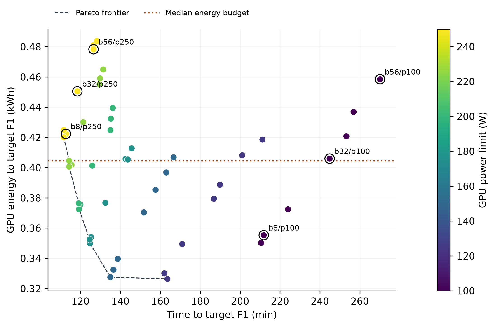
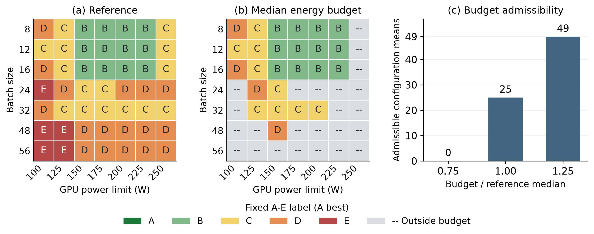
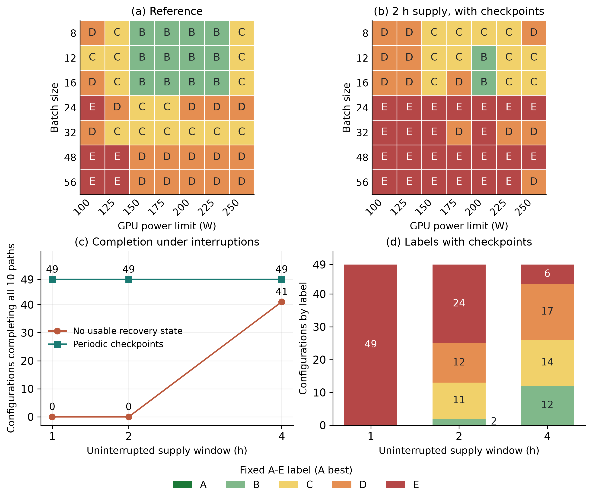
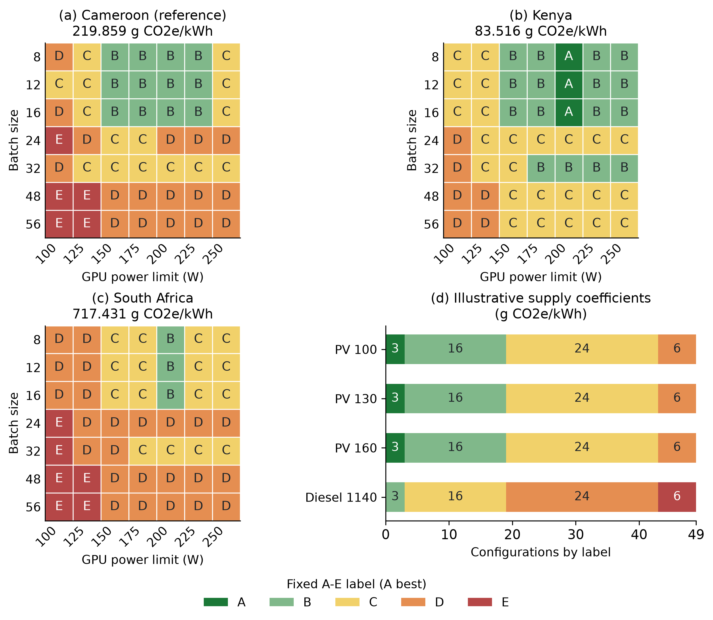
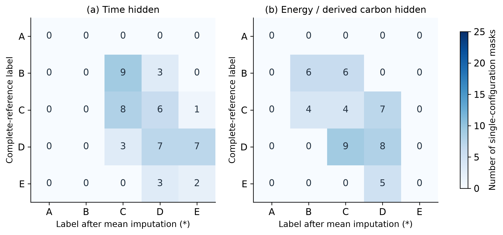

# Article 2 — Résultats calculés, version 0.1

19 novembre 2026. Analyse secondaire et simulations ; aucune nouvelle exécution de modèle.

Corpus : 49 configurations BERT/SQuAD sur V100, cible F1 84, 70 parcours d'apprentissage réutilisés sous sept plafonds de puissance. Les 490 lignes reconstruites ne sont pas 490 expériences électriques indépendantes.

## Six configurations illustratives

| Configuration | Temps de référence (min) | Énergie GPU (kWh) | Label | Temps avec coupures et sauvegardes (min) | Énergie simulée (kWh) | Label |
|---|---:|---:|:---:|---:|---:|:---:|
| b8/p100 | 211.85 | 0.3553 | D | 271.25 | 0.3895 | D |
| b8/p250 | 112.74 | 0.4223 | C | 126.76 | 0.4412 | D |
| b32/p100 | 244.87 | 0.4060 | D | 335.48 | 0.4567 | E |
| b32/p250 | 118.44 | 0.4505 | C | 123.53 | 0.4585 | D |
| b56/p100 | 270.15 | 0.4585 | E | 360.91 | 0.5107 | E |
| b56/p250 | 126.56 | 0.4783 | D | 140.67 | 0.4976 | D |

## Conclusions de la version calculée

- Budget médian : 25/49 configurations respectent le budget en moyenne ; les lettres ne changent pas. Les consommations individuelles restent dans budgets.csv, sans garantie d'autonomie réelle.
- Coupures centrales (2 h alimentées, 30 min hors tension, horizon 24 h) : sans état de reprise, 124/490 parcours reconstruits terminent, mais aucune configuration ne termine ses dix parcours. Avec sauvegardes additionnelles, les 49 configurations terminent leurs dix parcours ; 37 lettres changent.
- Avec seulement 1 h d'alimentation continue, toutes les configurations avec sauvegardes reçoivent E : l'échelle sature et ne discrimine plus. Les valeurs brutes deviennent indispensables.
- Facteurs nationaux : 31/49 lettres changent pour le Kenya, 18/49 pour l'Afrique du Sud. Le carbone reste proportionnel à l'énergie dans chaque contexte. Ces changements résultent de la calibration fixe et de l'agrégation, pas d'une inversion du classement énergétique physique.
- Imputation : masquer la durée modifie 32/49 lettres ; masquer l'énergie modifie 31/49 lettres. Les ensembles recommandés changent dans 12/49 et 10/49 masquages, contre 20/49 dans chacun des deux contrôles par omission. Cela ne prouve pas une supériorité générale de la moyenne.
- Type d'alimentation : sensibilité illustrative à des facteurs PV/diesel publiés, avec hypothèse de transfert simplifiée. Ce volet n'est pas une comparaison d'analyses de cycle de vie harmonisées.

## Figures

